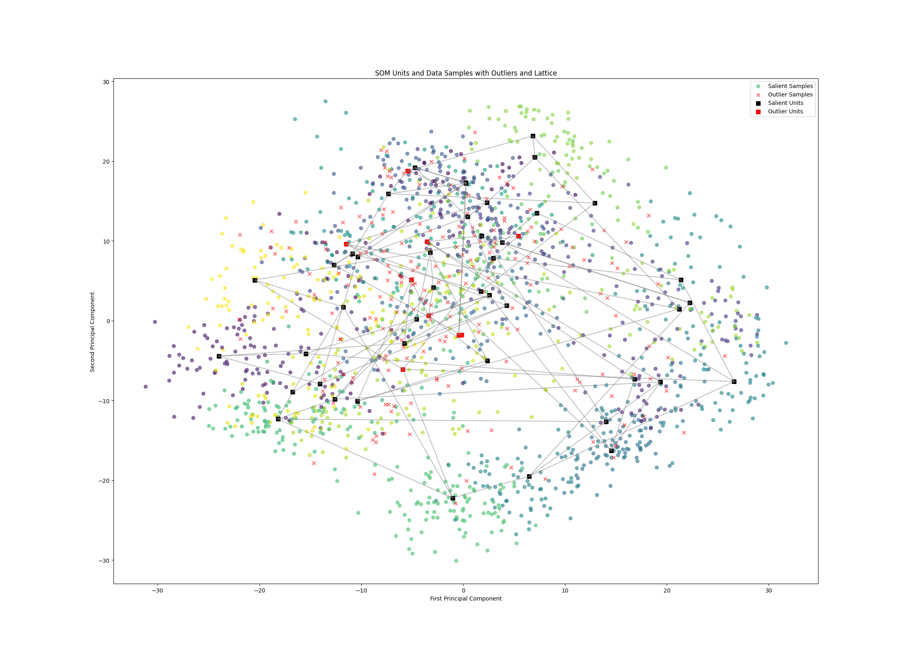
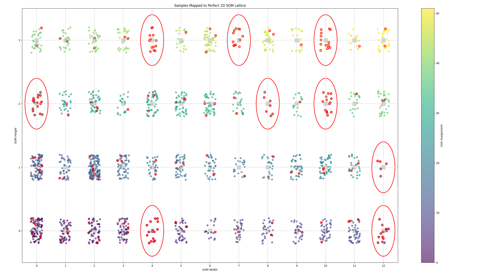

Rectifying Self Organizing Map (RSOM)
===============================

📎 **Paper 1:** Gölge, E., & Duygulu, P. 2013. Rectifying Self Organizing Maps for Automatic Concept Learning from Web Images

📎 **Paper 2:** Gölge, E., & Duygulu, P.. ConceptMap:Mining noisy web data for concept learning , The European Conference on Computer Vision (ECCV) 2014.

RSOM is an algorithm as an extension of well-known Self Organizing Map (SOM). It mimics SOM clustering and additionally detects outliers in the given dataset in the cluster level or instance level.
It is mainly used with image tasks but works as good with any other type of data.

## Installation

```
git clone https://github.com/erogol/RSOM.git
cd RSOM
python setup.py install
```

or

```
pip install git+https://github.com/erogol/RSOM.git
```

## Usage

Check ```sample_run.py``` for more.

```python
import torch
from sklearn.datasets import load_digits

from rsom import RSOM

# Load the digits dataset
data = load_digits().data
data = torch.from_numpy(data).float()
print(data.shape)

# Initialize SOM
som = RSOM(data, alpha_max=0.05, num_units=49)

# Train SOM
som.train_batch(num_epoch=1000, verbose=True)

# Get salient instances and units
salient_insts = som.salient_insts()
salient_units = som.salient_units()
```

`verbose=True` logs the progress at level INFO with the `logging` module. The module does not configure logging. Call `logging.basicConfig(level=logging.INFO)` to see the progress.

## Training modes and the learning rate

- **Full batch** (`batch_size=None`): the classic batch SOM. Each epoch sets each unit to the neighbourhood-weighted mean of the data. This mode does not use `alpha_max` and `alpha_min` for the weights.
- **Mini-batch** (`batch_size=B`): each step moves each unit toward the neighbourhood-weighted mean `M` of the batch: `W <- W + alpha * (M - W)`. `alpha` decreases linearly from `alpha_max` toward `alpha_min`. A larger `alpha` follows the last batches more closely. If one epoch has only a few steps (large `B`), use a larger `alpha` or more epochs.
- In the two modes, `alpha` sets the weight of each epoch in the unit saliency scores (`rho = 1 / alpha`, Eq. 3 of the paper).

## Outlier detection

RSOM marks outliers at two levels. `som.unit_saliency` and `som.inst_saliency` are boolean masks, and `False` means outlier.

- **Outlier units.** Each unit gets an excitation score (Eq. 3-4 of the paper). The scores are normalized to sum 1. A unit is an outlier when its score is not above `outlier_unit_thresh / num_units`. All samples of an outlier unit are outliers.
- **In-unit outliers.** A sample is an outlier when its distance to its unit is above the Tukey upper whisker `Q3 + inunit_whisker_factor * (Q3 - Q1)` of the distances in that unit (default factor 1.5). The rule uses the stored distance, which is the squared distance for `dist="euclidean"`. To use the old percentile rule, pass `inunit_outlier_thresh` (for example `95`). The percentile rule always flags about 5 % of each unit.

`outlier_unit_thresh` has a large effect, and the best value depends on the data. Measured on synthetic data (2000 samples in 5 Gaussian clusters plus 200 uniform noise samples, 10-D, 7x7 map, full batch, 200 epochs, mean of 5 seeds):

| `outlier_unit_thresh` | F1 of the noise detection | Outlier units (of 49) |
|---|---|---|
| 0.25 | 0.63 | 12.6 |
| 0.5 (default) | 0.88 | 20.4 |
| 0.75 | 0.87 | 21.4 |
| 1.0 | 0.76 | 23.0 |

Start with the default 0.5. Then examine the number of outlier units, `(~som.unit_saliency).sum()`, and some samples of these units before you use the result.

### Known limits

- The unit score follows the number of samples of a unit and of its neighbours (Spearman correlation with the cluster size: 0.96 on the synthetic data above). Thus a dense group of unrelated samples stays salient. In a test with 1900 samples in 5 clusters and a tight far group of 100 samples, 98 % of the far group stayed salient, and its unit had the highest score in 5 of 5 seeds. RSOM removes sparse noise; it does not remove a dense unrelated cluster. To flag such a group, set `outlier_group_share` (for example 0.1). This rule cuts long edges in a minimum spanning tree of the units and flags each part with less than this share of the samples. In the test above, it flagged 100 % of the far group in 5 of 5 seeds, with no change in F1 or in the clean flagged share. It does not flag a group above the share (for example 300 of 2200 samples). It can also flag a small real cluster: on the digits data, it flagged 1.2 % more samples.
- The results above are from synthetic data and the digits data on CPU. The image experiments of the paper were not repeated with this code.


## Citation

```
@misc{golge2013rectifyingselforganizingmaps,
      title={Rectifying Self Organizing Maps for Automatic Concept Learning from Web Images},
      author={Eren Golge and Pinar Duygulu},
      year={2013},
      eprint={1312.4384},
      archivePrefix={arXiv},
      primaryClass={cs.CV},
      url={https://arxiv.org/abs/1312.4384},
}
```

## Example Visuals

Visuals are generated using ```sample_run.py``` and digits dataset.




